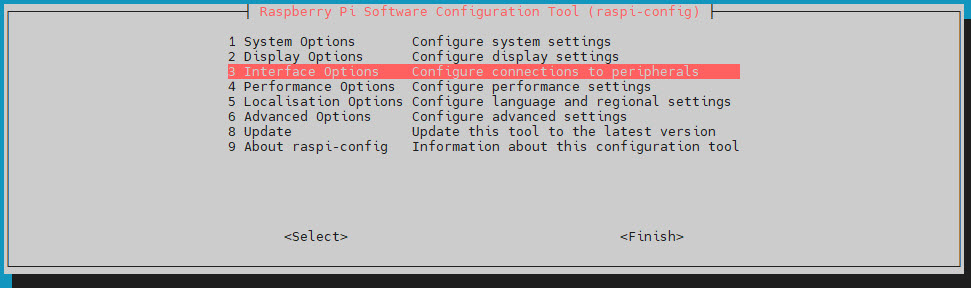
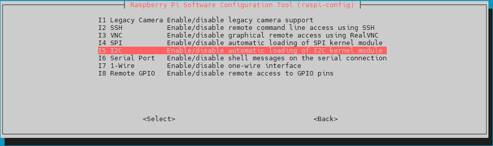
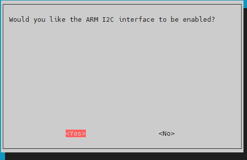

# SKU_RM0004
The project supports running on RaspberryPi, Ubuntu, [HomeAssistant](https://github.com/UCTRONICS/UCTRONICS_RM0004_HA),You can also use Python to call compiled DLLs on these platforms.
# RaspberryPi

## Deployment service
>  Clone SKU_RM0004 library 
```bash
git clone https://github.com/UCTRONICS/SKU_RM0004.git
```
> Compile 
```bash
cd SKU_RM0004
make clean && make 
```
## Add automatic start script
```bash
./deployment_service.sh   
```

**reboot your system**
```bash
sudo reboot
```
## How to uninstall the uctronics-display.service

```bash
sudo systemctl disable uctronics-display.service
sudo rm /etc/systemd/system/uctronics-display.service
sudo systemctl daemon-reload
```
## How to use NVMe 
***Note: only for Raspberry Pi 5 and UC-B86 NVMe hat***

https://github.com/UCTRONICS/SKU_RM0004/blob/main/data/NVMe_User_Guide.md

## Troubleshooting

### Screen is stuck on the UCTRONICS logo

 **reboot after making changes**

#### Enable ARM I2C through `raspi-config`
```bash
sudo raspi-config
```





#### Check for valid configuration in `/boot/firmware/config.txt`
```bash
...
dtparam=i2c_arm=on
...
# UCTronics LCD
dtparam=i2c_arm_baudrate=400000
...
# UCTronics Power Button
dtoverlay=gpio-shutdown,gpio_pin=4,active_low=1,gpio_pull=up
```
